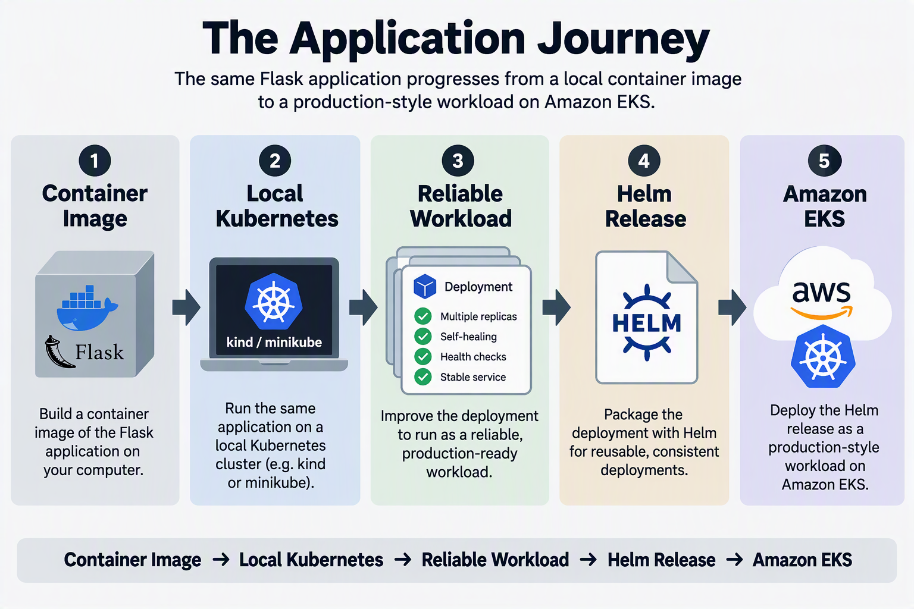

# Kubernetes in Practice

Companion labs for Victor Ebai’s *Kubernetes in Practice: Build, Operate, Troubleshoot, and Secure Kubernetes Applications with Confidence*.

## Get the book

**[Buy *Kubernetes in Practice* on Amazon UK](https://www.amazon.co.uk/dp/B0HPGS53FY)** · Paperback

## From Flask to Amazon EKS

Build a non-root Docker image for a small Python Flask service with `/`, `/healthz` and `/readyz`. Follow the same app through Kubernetes networking, probes, scaling, security and troubleshooting.



*Figure 0.1 from the book. The local labs use Minikube. Amazon EKS is optional.*

## Start locally

Use the [setup guide](docs/SETUP.md) for macOS, Linux or WSL 2. For Chapter 1, install Git and `curl` and make sure Docker is running. Install Minikube and `kubectl` for Chapter 2, and Helm for Chapter 9. The local chapters run without an AWS account.

```bash
git clone https://github.com/vebai/kubernetes-in-practice.git
cd kubernetes-in-practice/flask-app
docker build -t flask-app:v1.0.0 .
docker run --rm -d --name flask-app -p 127.0.0.1:5050:5000 flask-app:v1.0.0
curl --fail http://127.0.0.1:5050/healthz
docker stop flask-app
```

Once the app starts, `/healthz` returns `{"status":"alive"}`. If the first request arrives before Flask is ready, retry it before stopping the container. Next, follow [Chapter 2](chapters/chapter-02-local-cluster/README.md) to start Minikube and load the image.

## Choose your chapter

| Chapter | What you will practise | Files / guide |
|---|---|---|
| 1 | Build and verify the versioned, non-root Flask container | [Prepare the application](chapters/chapter-01-prepare-application/README.md) |
| 2 | Start Minikube, inspect context and run the first Pod | [Local cluster](chapters/chapter-02-local-cluster/README.md) |
| 3 | Deploy, scale, update and recover a workload | [Deployments](chapters/chapter-03-deployments/README.md) |
| 4 | Create a Service and trace the request path | [Services and DNS](chapters/chapter-04-services-dns/README.md) |
| 5 | Inject application configuration and handle lab secrets | [Configuration](chapters/chapter-05-configuration/README.md) |
| 6 | Add probes, resource controls and a CPU-based HPA | [Health and scaling](chapters/chapter-06-health-scaling/README.md) |
| 7 | Apply restricted workload security, RBAC and NetworkPolicy | [Security](chapters/chapter-07-security/README.md) |
| 8 | Diagnose common failures without guessing | [Troubleshooting](chapters/chapter-08-troubleshooting/README.md) |
| 9 | Build, lint and release the application through Helm | [Helm](chapters/chapter-09-helm/README.md) |
| 10 | Push an image to ECR and optionally deploy to Amazon EKS | [EKS deployment](chapters/chapter-10-eks/README.md) |
| 11 | Observe, secure and operate an EKS workload | [EKS operations](chapters/chapter-11-eks-operations/README.md) |
| 12 | Validate a production-style release and exercise recovery | [Final project](chapters/chapter-12-final-project/README.md) |

## Before applying manifests

- Check `kubectl config current-context` and `kubectl get nodes`. Verify the target namespace and image against the chapter guide.
- Chapter 7 needs a CNI that enforces NetworkPolicy. The manual lab uses the `security-lab` profile. The automated lab uses `book-k8s-security` with Calico and the `shop` namespace.
- The optional EKS labs require AWS CLI v2, `eksctl` and an appropriately authorised AWS identity. Read [EKS safety and costs](docs/EKS-SAFETY.md) and [safe cleanup](docs/CLEANUP.md) before creating chargeable resources.

## Validate the files

From the repository root, run the offline checks with Python 3 installed. Install PyYAML for YAML checks and Helm for chart checks.

```bash
bash tests/validate-files.sh
```

The script checks Python syntax, relative Markdown links and repository hygiene. With PyYAML installed, it also checks static YAML structure. With Helm installed, it also lints and renders the chart using the development values. These checks run without a cluster.

For runtime checks, use the separate [local chapter validation suite](validation/README.md) or the [staged AWS live-validation guide](validation/aws-live/README.md). See the [validation evidence](docs/VALIDATION-EVIDENCE.md) for the scope of previous runs and the [book-to-repo path map](docs/REPO-BOOK-PATHS.md) for the files used in each lab. If a lab fails, start with the [troubleshooting guide](docs/TROUBLESHOOTING.md).

## Continue with the book

**[Buy *Kubernetes in Practice* on Amazon UK](https://www.amazon.co.uk/dp/B0HPGS53FY)** for the complete exercises and guided troubleshooting investigations.
